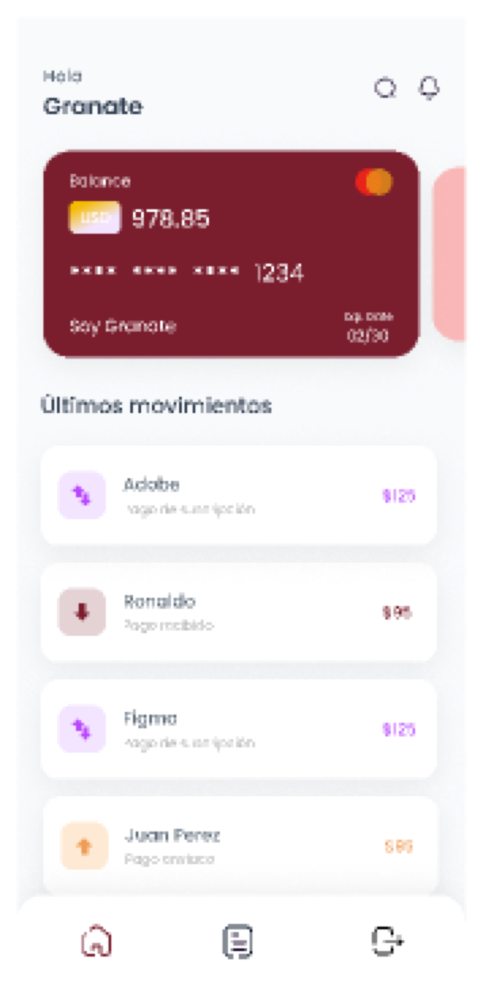
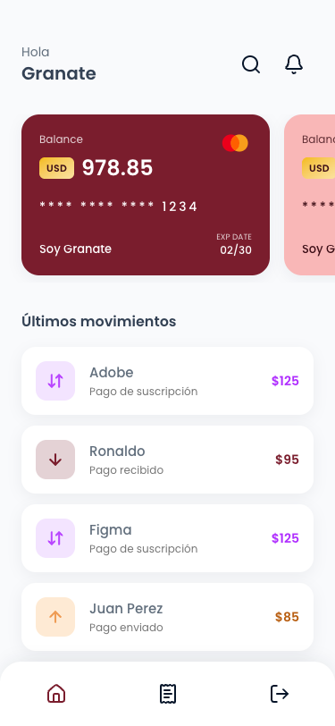
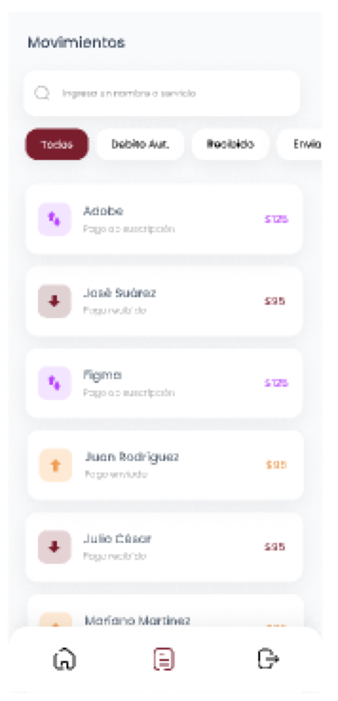
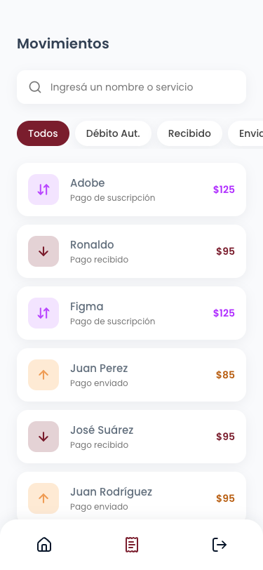

# GranaBank

Challenge técnico para Club Lanús. Es una billetera mobile-first para socios: login, inicio con tarjetas y últimos movimientos, y un listado de movimientos con búsqueda, filtros rápidos, scroll infinito y detalle. Está hecha con Next.js 16, TypeScript, PostgreSQL y Prisma, siguiendo [el diseño de Figma](https://www.figma.com/design/GXEt9rIWDil8nQN8ewOrVD/Challenge-t%C3%A9cnico).

La demo se publica en Vercel y el link queda en la sección About del repositorio. Para entrar, usuario `soygranate@clublanus.com` y contraseña `GRANATE1@`.

| Figma                                                                               | Implementación                                                                            |
| ----------------------------------------------------------------------------------- | ----------------------------------------------------------------------------------------- |
|              |              |
|  |  |

## Cómo correrlo

Hace falta Docker. Para desarrollar, además, Node 24 y pnpm 10 (`corepack enable`).

Con Docker, un solo comando levanta la base, aplica las migraciones, carga los datos de demo y sirve la app en http://localhost:3000:

```bash
docker compose --profile app up --build
```

Para desarrollo local, con la base en Docker y Next en modo dev:

```bash
cp .env.example .env
pnpm install
pnpm db:up && pnpm db:deploy && pnpm db:seed
pnpm dev
```

| Script                                             | Qué hace                                           |
| -------------------------------------------------- | -------------------------------------------------- |
| `pnpm test`                                        | Tests unitarios y de componentes                   |
| `pnpm test:db:up && pnpm test:integration`         | Servicios y API contra un Postgres efímero         |
| `pnpm build && pnpm test:e2e`                      | Playwright contra el build de producción           |
| `pnpm typecheck`, `pnpm lint`, `pnpm format:check` | Chequeos de calidad                                |
| `pnpm db:reset`                                    | Recrea la base y vuelve a cargar los datos de demo |

## Deploy

Vercel, con Postgres de Neon conectado desde el Marketplace (región São Paulo). En producción, el build (`pnpm vercel-build`) aplica las migraciones antes de `next build`. Los previews no migran, así un PR sin mergear nunca toca la base de producción; si se activa el branching de Neon por preview, cada uno tiene su propia base y se puede migrar ahí también.

A la URL de Neon conviene sumarle `connect_timeout=15`, porque la base escala a cero y la primera conexión tarda unos segundos. Los datos de demo se cargan una sola vez con `pnpm db:seed` apuntando a la base de producción.

## Decisiones técnicas

- Una sola app Next.js con el backend como capa interna (`src/server`). El enunciado admite API routes, el login usa una cookie httpOnly del mismo origen (sin CORS) y hay un solo deploy. Las páginas leen directo de esa capa, como recomienda Next, y la API REST (`/api/v1/movements`) la consume el listado interactivo y queda lista para otros clientes, como una app nativa.
- Prisma 7 sobre PostgreSQL 18. El schema se lee fácil y trae migraciones y seed. Los montos se guardan en centavos enteros y la base tiene restricciones CHECK para las reglas que el schema no expresa.
- Autenticación propia y chica. La contraseña se guarda con Argon2id y la sesión es un token aleatorio en una cookie httpOnly que la base guarda hasheado, así el logout la revoca de verdad. El error de login es genérico y tarda lo mismo exista o no el email, y después de entrar solo se redirige a rutas internas. Con un solo usuario de email y contraseña, una librería de auth sumaba más de lo que resolvía.
- En Movimientos, la primera página se renderiza en el servidor y después TanStack Query maneja la búsqueda con debounce, los filtros y el scroll infinito con paginación por cursor. El estado vive en la URL, así que se puede compartir y el botón atrás funciona. La búsqueda ignora acentos y mayúsculas: "jose" encuentra "José Suárez".
- Cada vista tiene estado de carga (skeletons), de error con reintento y vacío. En el listado se distingue "no tenés movimientos" de "no hay resultados", con una acción para limpiar filtros. El detalle devuelve un 404 real para ids inexistentes o ajenos, y la API responde los errores en formato RFC 9457.
- Del Figma salen los colores, la tipografía (Poppins), los radios y las sombras. Algunos grises claros y los colores de los montos no llegaban al contraste WCAG AA, así que usé el tono más cercano que sí cumple. Lo que no estaba diseñado (detalle, estados, notificaciones y desktop) sigue el mismo estilo; en desktop la app se ve en una columna del ancho de un teléfono.
- TypeScript estricto, ESLint y Prettier, commits convencionales validados con Lefthook y commitlint, y CI en GitHub Actions con Postgres real.

Hay más detalle de capas, flujos y decisiones en [docs/architecture.md](docs/architecture.md).

## Qué mejoraría con más tiempo

- Rate limiting y bloqueo temporal del login.
- Content-Security-Policy con nonces.
- Índices `pg_trgm` y `unaccent` para que la búsqueda escale a muchos movimientos.
- Calcular el saldo desde un ledger de movimientos en lugar de guardarlo.
- Mostrar el detalle como bottom sheet sobre el listado (intercepting routes).
- Documentación OpenAPI de la API.
- Observabilidad (Sentry, logs estructurados) y tests visuales de regresión.
- PWA para instalarla en el teléfono.
- Tomar los tokens exactos desde la API de Figma, porque este trabajo partió de capturas del diseño público.
