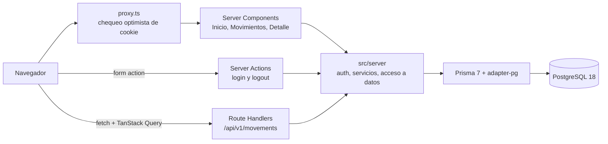

# Arquitectura

## Capas

| Carpeta          | Responsabilidad                                                                              |
| ---------------- | -------------------------------------------------------------------------------------------- |
| `src/app`        | Rutas: páginas, layouts, estados de carga, error y 404, y route handlers finos               |
| `src/features/*` | UI por dominio: auth, cards, home y movements                                                |
| `src/components` | Primitivas del sistema de diseño y layout                                                    |
| `src/server`     | Backend: entorno, Prisma, sesiones, servicios y helpers HTTP. Todo marcado con `server-only` |
| `src/shared`     | Contratos que comparten cliente y servidor: schemas Zod, DTOs y helpers puros                |
| `src/lib`        | Formateo y utilidades de UI                                                                  |

## Flujos

Una página protegida pasa primero por `proxy.ts`, que manda a `/login?next=…` si no hay cookie de sesión. Después el layout del área autenticada valida la sesión contra la base con `requireUser()`, y la página llama a los servicios directamente, sin hacer un request HTTP a la propia API.

Movimientos renderiza en el servidor la primera página según `?q=` y `?type=`. Desde ahí, `MovementsExplorer` consulta `GET /api/v1/movements` con TanStack Query: debounce de 300 ms, cancelación de pedidos viejos, resultados anteriores visibles mientras carga y paginación por cursor.

El login es una Server Action. Valida con Zod, verifica la contraseña con Argon2id, crea la sesión (un token aleatorio en una cookie httpOnly que la base guarda hasheado) y redirige a `next` solo si es una ruta interna.

## Decisiones

| Decisión                                              | Por qué                                                                                                                                                                                           |
| ----------------------------------------------------- | ------------------------------------------------------------------------------------------------------------------------------------------------------------------------------------------------- |
| Una sola app Next.js con el backend como capa interna | El enunciado admite API routes. La cookie es del mismo origen, hay un solo deploy y los tipos van de punta a punta. `src/server` se puede extraer a un servicio aparte si aparecen otros clientes |
| Prisma 7 y PostgreSQL 18                              | Schema legible, migraciones y seed. Restricciones CHECK en SQL para las reglas que el schema no expresa                                                                                           |
| Sesiones en la base en lugar de JWT                   | El logout las revoca de verdad. Con un solo usuario de email y contraseña, una librería de auth agrega más de lo que resuelve                                                                     |
| Montos en centavos enteros                            | Evita errores de redondeo con decimales                                                                                                                                                           |
| Paginación por cursor `(occurred_at, id)`             | Es estable aunque entren movimientos nuevos y aprovecha el índice compuesto                                                                                                                       |
| Errores RFC 9457 (`application/problem+json`)         | Un contrato de errores estándar y predecible                                                                                                                                                      |
| Un `loading.tsx` por route group                      | El detalle no tiene loading boundary para que un id inexistente devuelva un 404 real y no un 200 en streaming                                                                                     |
| Comodines escapados en la búsqueda                    | Prisma pasa `%` y `_` tal cual al `LIKE`; se escapan para que buscar "%" no devuelva todo                                                                                                         |
